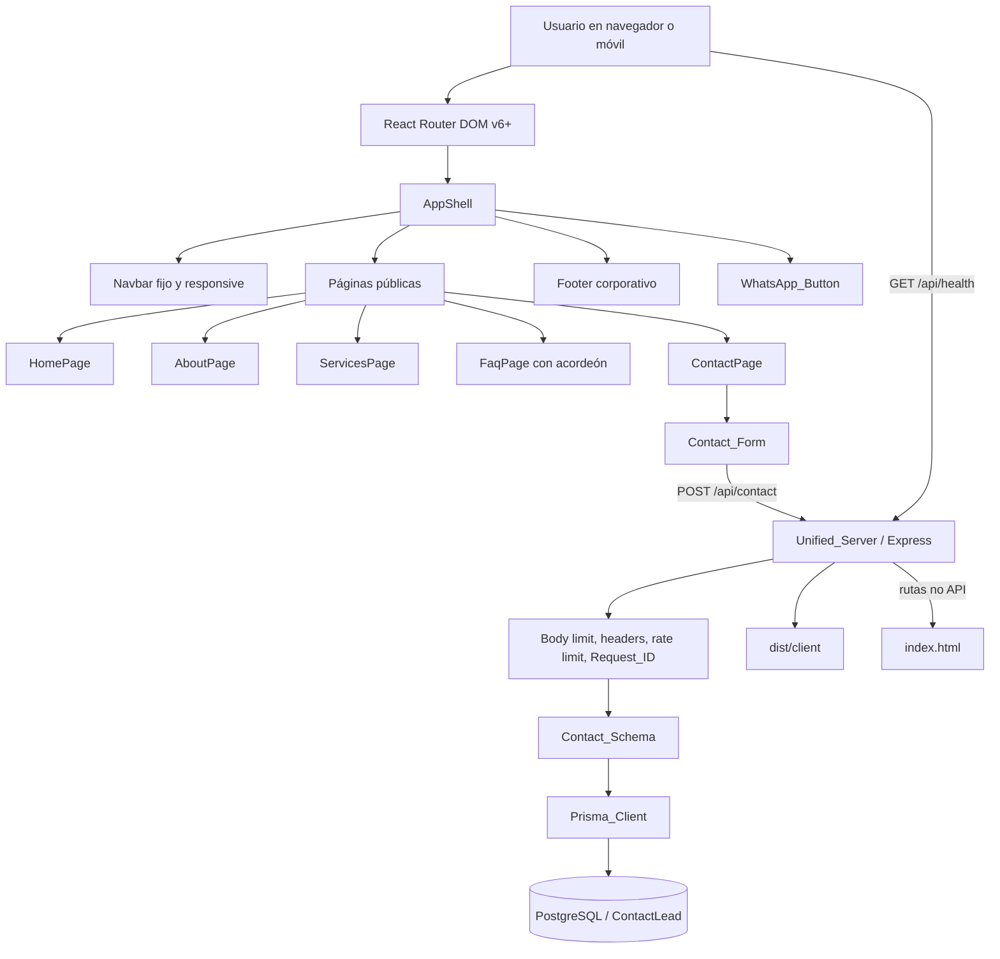
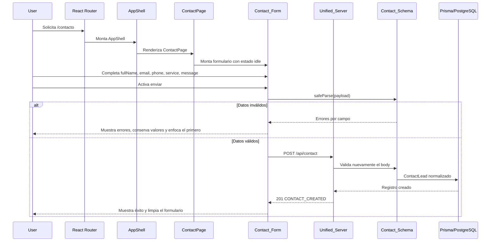
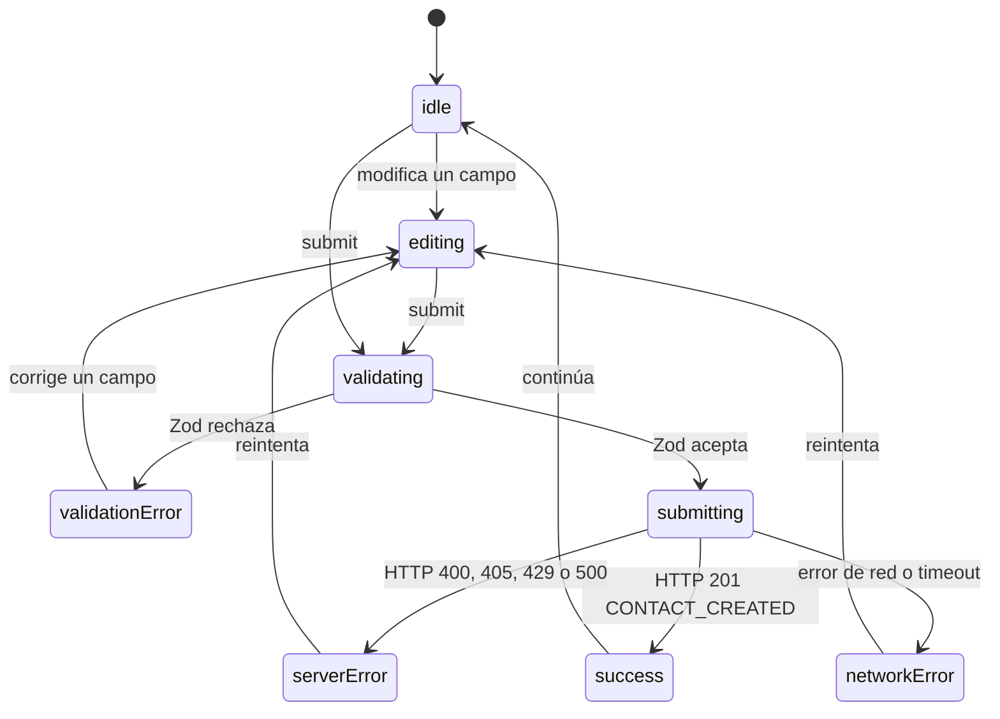

# Diseño técnico: multiservicios-sanabria-web

## Overview

Este documento define el diseño de alto nivel y de bajo nivel para la aplicación web corporativa de Multiservicios Sanabria. `requirements.md` es el contrato funcional principal; este documento conserva las decisiones técnicas válidas del diseño anterior y las alinea con sus nombres, campos, respuestas, reglas de validación y criterios de aceptación.

La solución será una SPA React 18+ con TypeScript, Vite, React Router DOM v6+, Tailwind CSS y Lucide React. Un servidor unificado Node.js con Express y TypeScript expondrá la API bajo `/api/*`, servirá `dist/client` en producción y escuchará en un único puerto. PostgreSQL se accederá mediante Prisma ORM; Zod será compartido por el navegador y el servidor. El despliegue usará una imagen Docker multi-stage basada en `node:20-alpine`, con `openssl`, migraciones Prisma y el comando de arranque exigido.

El alcance incluye las cinco páginas públicas `/`, `/nosotros`, `/servicios`, `/faq` y `/contacto`; `Navbar`, `Footer` y `WhatsApp_Button` compartidos; CTAs de servicios; acordeón FAQ; formulario de contacto; `POST /api/contact`; `GET /api/health`; persistencia de `ContactLead`; contenido literal mediante `Content_Fixture`; accesibilidad, seguridad, pruebas basadas en propiedades y empaquetado para Dokploy. No se agregan paneles administrativos, autenticación, cambios de estado de leads ni otras funcionalidades que no estén en el contrato.

## 2. Fuente de verdad del contenido corporativo

La solicitud original contiene el copy aprobado. La implementación debe transcribirlo literalmente al `Content_Fixture`, incluidos acentos, mayúsculas, signos, orden, nombres de secciones, datos corporativos, CTAs, preguntas frecuentes y mensajes de negocio. El fixture no puede resumir, corregir, traducir, reordenar ni inventar textos.

`Content_Fixture` será un módulo versionado y separado de los componentes de presentación. Cada bloque visible de navegación, Inicio, Quiénes Somos, Servicios, FAQ, Contacto, footer, CTA, dato corporativo y mensaje de negocio aprobado tendrá una entrada identificable. Las páginas solo consumirán esas entradas y las renderizarán como nodos React escapados. No se usará `dangerouslySetInnerHTML` para el copy corporativo.

El fixture debe cubrir como mínimo estas categorías:

- navegación con los cinco enlaces públicos;
- hero, propuesta corporativa, beneficios, servicios destacados y CTA de Inicio;
- identidad, historia, valores y demás bloques de Quiénes Somos;
- cada servicio, su descripción y su CTA personalizado;
- cada pregunta y respuesta del acordeón FAQ, en el orden aprobado;
- datos corporativos, canales, CTA de WhatsApp y etiquetas del formulario de Contacto;
- footer y mensajes visibles de negocio o de estado definidos por la solicitud.

```typescript
export type PublicPath = '/' | '/nosotros' | '/servicios' | '/faq' | '/contacto';

export interface ContentFixture {
  nav: {
    home: string;
    about: string;
    services: string;
    faq: string;
    contact: string;
  };
  home: {
    hero: Record<string, string>;
    benefits: Array<Record<string, string>>;
    featuredServices: Array<Record<string, string>>;
    cta: Record<string, string>;
  };
  about: Record<string, string>;
  services: Array<{
    id: string;
    title: string;
    description: string;
    cta: string;
    ctaHref: PublicPath;
  }>;
  faq: {
    title: string;
    items: Array<{ question: string; answer: string }>;
  };
  contact: Record<string, string>;
  footer: Record<string, string>;
  messages: Record<string, string>;
}

export const COPY_SOURCE = 'original-feature-request' as const;
```

Los valores concretos de `Content_Fixture` deben proceder de la solicitud original y no se sustituyen por ejemplos inventados en la implementación.

El enlace de WhatsApp se construye desde `WHATSAPP_NUMBER`, después de normalizar caracteres de formato permitidos. Para la configuración aprobada, el resultado canónico es `https://wa.me/584162459941`. Un valor inválido debe hacer fallar la validación de configuración para producción sin exponer secretos al navegador.

## Architecture

### 3.1 Decisiones principales

| Decisión | Elección | Motivo |
|---|---|---|
| Aplicación web | React 18+ con TypeScript y Vite | Proporciona una SPA tipada y compilable para producción. |
| Navegación | React Router DOM v6+ | Mantiene rutas públicas estables y permite navegación sin recarga completa. |
| Estilos | Tailwind CSS con tokens de marca | Centraliza responsive design y evita colores de marca dispersos. |
| Iconos | Lucide React | Proporciona iconos consistentes y accesibles. |
| API | Express con TypeScript | Expone `/api/contact`, `/api/health` y errores JSON en el mismo proceso. |
| Persistencia | PostgreSQL mediante Prisma ORM | Proporciona acceso tipado, parametrizado y migraciones versionadas. |
| Validación | Zod compartido | Mantiene las mismas reglas en cliente y servidor. |
| Producción | Servidor unificado en un puerto | Sirve API y cliente compilado de forma compatible con Dokploy. |
| WhatsApp | Enlace HTTPS `wa.me` | Permite contacto directo desde móvil y escritorio. |

### 3.2 Arquitectura de componentes



### 3.3 Secuencia de navegación y contacto



### 3.4 Estructura lógica de carpetas

```text
client/
  src/
    app/
    components/layout/
    components/ui/
    features/contact/
    pages/
    content/
    styles/
server/
  src/
    index.ts
    routes/
    services/
    middleware/
    lib/
shared/
  validation/
  contracts/
prisma/
  schema.prisma
  migrations/
dist/
  client/
  server/
```

El cliente se compila en `dist/client`. El servidor TypeScript se compila en `dist/server` y debe generar `dist/server/index.js` como entry point productivo.

## 4. Rutas, layout y componentes

### 4.1 Rutas públicas

| URL | Página | Responsabilidad |
|---|---|---|
| `/` | `HomePage` | Renderiza el hero, propuesta corporativa, beneficios, servicios destacados y CTA de Inicio desde `Content_Fixture`. |
| `/nosotros` | `AboutPage` | Renderiza identidad, historia, valores y los demás bloques aprobados. |
| `/servicios` | `ServicesPage` | Renderiza cada servicio, su descripción y su CTA personalizado. |
| `/faq` | `FaqPage` | Renderiza todas las preguntas y respuestas mediante un acordeón accesible, en el orden del fixture. |
| `/contacto` | `ContactPage` | Renderiza datos corporativos, canales, CTA de WhatsApp y `Contact_Form`. |
| cualquier otra ruta no API | `NotFoundPage` | Ofrece navegación hacia una página pública válida sin revelar infraestructura. |

Configuración conceptual del router:

```typescript
const router = createBrowserRouter([
  {
    element: <AppShell />,
    children: [
      { path: '/', element: <HomePage /> },
      { path: '/nosotros', element: <AboutPage /> },
      { path: '/servicios', element: <ServicesPage /> },
      { path: '/faq', element: <FaqPage /> },
      { path: '/contacto', element: <ContactPage /> },
      { path: '*', element: <NotFoundPage /> },
    ],
  },
]);
```

El servidor entrega `dist/client/index.html` para solicitudes no API que no correspondan a un archivo estático. Las solicitudes que comienzan con `/api` se procesan como API y quedan excluidas del fallback HTML. Una ruta `/api/*` desconocida recibe un error JSON HTTP 404.

### 4.2 AppShell, Navbar, Footer y WhatsApp

```typescript
export interface AppShellProps {
  children?: React.ReactNode;
}

export interface NavItem {
  label: string;
  href: '/' | '/nosotros' | '/servicios' | '/faq' | '/contacto';
}

export interface WhatsAppButtonProps {
  href: `https://wa.me/${string}`;
  ariaLabel: string;
}

export function AppShell(props: AppShellProps): JSX.Element;
export function Navbar(): JSX.Element;
export function Footer(): JSX.Element;
export function WhatsAppButton(props: WhatsAppButtonProps): JSX.Element;
```

Responsabilidades:

- `AppShell` monta `Navbar`, el contenido de la ruta, `Footer` y `WhatsApp_Button` en cada `Public_Page`.
- `Navbar` muestra la marca y los cinco enlaces en escritorio, y un control accesible para abrir y cerrar esos cinco enlaces en móvil.
- `Navbar` usa `NavLink` para indicar la ruta activa con un estado visible que no dependa únicamente del color.
- El contenido reserva espacio superior para que el navbar fijo no lo cubra.
- `Footer` consume únicamente copy y enlaces aprobados por `Content_Fixture`.
- `WhatsApp_Button` construye la URL desde la configuración validada, tiene un `aria-label` descriptivo y usa `target="_blank"` con `rel="noreferrer"` cuando abre una pestaña nueva.
- El botón flotante mantiene separación suficiente de campos, CTAs y controles en viewport móvil.

### 4.3 CTAs de servicios y acordeón FAQ

Cada CTA de servicio se renderiza desde la entrada correspondiente de `Content_Fixture`; no se define un destino alternativo en el componente. El componente debe conservar la etiqueta y el orden del fixture y navegar al destino aprobado, normalmente una ruta pública definida por el contenido.

Cada pregunta del FAQ se representa como un control de acordeón con nombre accesible, estado expandido y relación con su panel. La respuesta se muestra u oculta sin perder el orden del fixture y se puede operar completamente con teclado.

### 4.4 Tokens visuales y responsive design

Los tokens de identidad se definirán en la configuración de Tailwind:

```typescript
export const brandTokens = {
  background: '#0A0A0A',
  surface: '#171717',
  surfaceRaised: '#1E1E1E',
  border: '#262626',
  accent: '#10B981',
  cta: '#F97316',
  ctaHover: '#EA580C',
  textPrimary: '#F8FAFC',
  textSecondary: '#94A3B8',
} as const;
```

Reglas:

- `#0A0A0A` es el fondo base.
- `#171717` y `#1E1E1E` son superficies de tarjetas.
- `#262626` es el borde sutil.
- `#10B981` se usa en acentos, iconos, badges, estados activos y focos visibles.
- `#F97316` se usa en CTAs principales y `#EA580C` en hover/focus apropiado de esos CTAs.
- `#F8FAFC` se usa en títulos y `#94A3B8` en párrafos.
- Los componentes consumen tokens Tailwind y no dispersan hexadecimales de marca.
- Las cinco páginas deben funcionar sin scroll horizontal en móvil, tablet y escritorio.
- `prefers-reduced-motion` reduce o elimina animaciones no esenciales.

## Components and Interfaces

### 5.1 `Contact_Schema` y `ContactLeadInput`

El formulario, el cliente API y el servidor usan exactamente estos nombres: `fullName`, `email`, `phone`, `service` y `message`. El objeto es estricto, por lo que los campos desconocidos se rechazan. `phone` es opcional semánticamente; el formulario puede enviarlo vacío y la normalización lo convierte en ausencia para persistirlo como `NULL`.

```typescript
import { z } from 'zod';

const optionalPhoneSchema = z.preprocess(
  (value) =>
    typeof value === 'string' && value.trim() === ''
      ? undefined
      : value,
  z
    .string()
    .trim()
    .min(7)
    .max(30)
    .regex(/^[+()\d\s.-]+$/)
    .optional(),
);

export const contactSchema = z
  .object({
    fullName: z.string().trim().min(2).max(100),
    email: z.string().trim().email().max(254),
    phone: optionalPhoneSchema,
    service: z.string().trim().min(1).max(100),
    message: z.string().trim().min(10).max(2000),
  })
  .strict();

export type ContactLeadInput = z.infer<typeof contactSchema>;

export interface ContactCreatedResponse {
  success: true;
  code: 'CONTACT_CREATED';
}

export interface ApiErrorResponse {
  error: {
    code:
      | 'VALIDATION_ERROR'
      | 'RATE_LIMITED'
      | 'PERSISTENCE_ERROR'
      | 'INTERNAL_ERROR';
    message: string;
    fields?: Partial<Record<keyof ContactLeadInput, string[]>>;
  };
}

export interface HealthResponse {
  status: 'ok';
}
```

Reglas de `Contact_Schema`:

- `fullName` se recorta y acepta de 2 a 100 caracteres.
- `email` se recorta, debe ser válido y acepta hasta 254 caracteres.
- `phone`, si no está vacío, se recorta, acepta de 7 a 30 caracteres y solo permite dígitos, espacios, `+`, `(`, `)`, `.` y `-`.
- `service` se recorta y acepta de 1 a 100 caracteres.
- `message` se recorta y acepta de 10 a 2000 caracteres.
- El navegador y el servidor importan este mismo esquema y aplican las mismas reglas.
- El servidor vuelve a validarlo antes de invocar Prisma.

### 5.2 `GET /api/health`

- Método: `GET`.
- Respuesta saludable: HTTP `200` con `{ "status": "ok" }`.
- No consulta `ContactLead`, Prisma ni otra tabla de negocio.
- Está disponible cuando el proceso HTTP está listo.

### 5.3 `POST /api/contact`

Request lógico:

```typescript
export interface CreateContactLeadRequest {
  fullName: string;
  email: string;
  phone?: string;
  service: string;
  message: string;
}
```

El formulario mantiene los cinco controles visibles, incluido `phone`. En el transporte se usa el mismo conjunto de campos y ningún campo adicional; un `phone` vacío se normaliza antes de persistir.

Comportamiento exitoso:

1. El límite de body JSON se aplica antes del esquema.
2. El servidor valida el body con `contactSchema`.
3. La entrada se normaliza sin mutar el body original.
4. Prisma crea exactamente un `ContactLead`.
5. La respuesta es HTTP `201` con `{ "success": true, "code": "CONTACT_CREATED" }` y no contiene `id` ni otros identificadores internos.

Respuestas de error:

| Condición | HTTP | Código |
|---|---:|---|
| JSON malformado, campos inválidos o campos desconocidos | 400 | `VALIDATION_ERROR` |
| Body por encima del límite | 400 o 413 | Error JSON de body inválido |
| Método distinto de `POST` en `/api/contact` | 405 | Error JSON de método no permitido |
| Origen por encima del límite configurado | 429 | `RATE_LIMITED` |
| Fallo de persistencia | 500 | `PERSISTENCE_ERROR` o `INTERNAL_ERROR` |

Las respuestas no incluyen SQL, stack traces, credenciales, variables de entorno ni detalles internos de Prisma.

### 5.4 Contrato del servidor unificado

```typescript
import type { Express } from 'express';
import type { PrismaClient } from '@prisma/client';

export interface UnifiedServerOptions {
  prisma: PrismaClient;
  clientDistPath: string;
  nodeEnv: 'development' | 'test' | 'production';
}

export function createServer(options: UnifiedServerOptions): Express;
export function startServer(): Promise<void>;
```

El servidor unificado:

1. valida configuración de producción, incluido `WHATSAPP_NUMBER`;
2. aplica límite de body JSON, cabeceras de seguridad, rate limit de contacto y `Request_ID`;
3. monta `/api/health` y `/api/contact`;
4. procesa `/api/*` antes del fallback de SPA;
5. sirve archivos estáticos desde `dist/client`;
6. entrega `index.html` solo a rutas no API que no sean archivos estáticos;
7. escucha en `Number(process.env.PORT) || 3000`.

## Data Models

### 6.1 Modelo canónico

`ContactLead` contiene exactamente los campos `id`, `fullName`, `email`, `phone`, `service`, `message` y `createdAt`. No contiene `name`, `status`, `updatedAt` ni otros campos.

```typescript
export interface ContactLead {
  id: string;
  fullName: string;
  email: string;
  phone: string | null;
  service: string;
  message: string;
  createdAt: Date;
}
```

Esquema Prisma equivalente:

```prisma
model ContactLead {
  id        String   @id @default(cuid())
  fullName  String   @db.VarChar(100)
  email     String   @db.VarChar(254)
  phone     String?  @db.VarChar(30)
  service   String   @db.VarChar(100)
  message   String   @db.Text
  createdAt DateTime @default(now())
}
```

Reglas de persistencia:

- Prisma genera `id` al crear el registro.
- La base de datos genera `createdAt` con `@default(now())`.
- `fullName`, `email`, `service` y `message` se guardan después de la normalización definida por Zod.
- `phone` se guarda como `NULL` cuando está ausente o vacío después de normalizar.
- La operación de creación envía exclusivamente `fullName`, `email`, `phone`, `service` y `message`; `id` y `createdAt` los genera Prisma/la base de datos.
- No se agregan estados, timestamps de actualización ni endpoint público de administración.

### 6.2 Migraciones y conexión

- `prisma/schema.prisma` es la fuente del esquema de persistencia.
- Los cambios se versionan en `prisma/migrations/`.
- `DATABASE_URL` se obtiene del entorno del servidor y no entra en el bundle del cliente.
- Prisma ejecuta operaciones parametrizadas; no se construye SQL mediante concatenación.
- El despliegue ejecuta `npx prisma migrate deploy` antes de arrancar el servidor.
- Si la migración falla, el servidor no se inicia como saludable.

## 7. Contact_Form: estados y accesibilidad

### 7.1 Estado de los valores

Los cinco controles del formulario son `fullName`, `email`, `phone`, `service` y `message`. Para conservar siempre el valor introducido por el usuario, el estado de presentación usa strings, incluido `phone` vacío:

```typescript
export interface ContactFormValues {
  fullName: string;
  email: string;
  phone: string;
  service: string;
  message: string;
}

export type ContactFormStatus =
  | 'idle'
  | 'editing'
  | 'validating'
  | 'submitting'
  | 'validationError'
  | 'serverError'
  | 'networkError'
  | 'success';

export interface ContactFormState {
  status: ContactFormStatus;
  values: ContactFormValues;
  fieldErrors: Partial<Record<keyof ContactFormValues, string[]>>;
  formError?: string;
}
```

Transiciones:



Reglas:

- Mientras `status` es `submitting`, el control de envío queda deshabilitado y un segundo submit no inicia otra solicitud.
- La validación local muestra errores junto al campo, conserva valores y enfoca el primer campo inválido.
- Un error HTTP o de red conserva todos los valores y permite reintentar.
- Solo HTTP `201` con `CONTACT_CREATED` pasa a `success` y limpia los valores.
- Los errores y estados de éxito se anuncian en una región `aria-live`.
- Cada `label` se asocia a su control; cada error se asocia mediante `aria-describedby` o una relación equivalente.
- El foco `:focus-visible` es distinguible mediante el color de acento o CTA correspondiente.

## 8. Diseño de bajo nivel: funciones y especificaciones formales

### 8.1 Firmas principales

```typescript
export function normalizeContactInput(
  input: ContactLeadInput,
): ContactLeadInput;

export function validateContactInput(
  input: unknown,
):
  | { success: true; data: ContactLeadInput }
  | {
      success: false;
      fieldErrors: Partial<Record<keyof ContactFormValues, string[]>>;
    };

export async function createContactLead(
  prisma: PrismaClient,
  input: ContactLeadInput,
): Promise<ContactLead>;

export async function postContactHandler(
  req: Request,
  res: Response,
  dependencies: { prisma: PrismaClient },
): Promise<void>;

export async function submitContactForm(
  values: ContactFormValues,
  fetcher: typeof fetch,
): Promise<ContactFormState>;

export function buildWhatsAppUrl(
  whatsappNumber: string,
): `https://wa.me/${string}`;

export function resolvePublicRoute(
  pathname: string,
): 'home' | 'about' | 'services' | 'faq' | 'contact' | 'notFound';
```

### 8.2 `normalizeContactInput`

**Precondiciones**

- `input` cumple `ContactLeadInput`.
- Los valores de texto ya son strings y no contienen `null`.

**Postcondiciones**

- Devuelve un objeto nuevo y no muta `input`.
- `fullName`, `email`, `service` y `message` no tienen espacios externos.
- `phone` se recorta; un valor ausente o vacío se representa como `undefined` antes de persistir.
- Conserva exactamente los campos del contrato y no agrega claves.
- La normalización es idempotente.

**Invariantes**

- Los campos normalizados permanecen dentro de sus límites de longitud.
- No se ejecuta ninguna escritura en la base de datos.

### 8.3 `validateContactInput`

**Precondiciones**

- `input` puede ser cualquier valor proveniente de una frontera de confianza.

**Postcondiciones**

- Retorna `success: true` si y solo si el valor cumple `contactSchema`.
- Rechaza campos desconocidos y JSON con forma inválida.
- En error devuelve issues serializables por campo.
- No muta el valor recibido.

**Invariantes**

- Cada issue conserva la asociación con `fullName`, `email`, `phone`, `service` o `message`.
- Un resultado inválido no habilita persistencia.

### 8.4 `createContactLead`

**Precondiciones**

- `input` fue validado por `contactSchema`.
- `prisma` está disponible y configurado con `DATABASE_URL`.

**Postcondiciones**

- En éxito crea exactamente un registro `ContactLead`.
- La escritura contiene solo `fullName`, `email`, `phone`, `service` y `message`.
- `phone` se envía como `null` cuando no tiene valor.
- Devuelve un registro con exactamente `id`, `fullName`, `email`, `phone`, `service`, `message` y `createdAt`.
- Una excepción de Prisma se propaga al manejador de errores y no se convierte en falso éxito.

**Invariantes**

- No se escribe antes de finalizar la validación.
- No se aceptan propiedades distintas del modelo canónico.

### 8.5 `postContactHandler`

**Precondiciones**

- Express ya aplicó el límite de body JSON.
- `req.body` representa JSON parseado o un error de parsing controlable.
- La dependencia `prisma` está disponible.

**Postcondiciones**

- JSON malformado, campos inválidos o campos desconocidos producen HTTP `400` con `VALIDATION_ERROR` y no invocan `contactLead.create`.
- Un body válido produce una sola llamada de creación, HTTP `201` y `CONTACT_CREATED`.
- Un método distinto de `POST` produce HTTP `405`.
- Un rate limit excedido produce HTTP `429` con `RATE_LIMITED`.
- Un fallo de persistencia produce HTTP `500` sin filtrar detalles internos.
- La respuesta pública no contiene `id` ni `createdAt`.

**Invariantes**

- Ningún input no validado alcanza Prisma.
- Cada request termina con una única respuesta HTTP.

### 8.6 `submitContactForm`

**Precondiciones**

- `values` contiene los cinco controles del formulario.
- `fetcher` cumple el contrato mínimo de `fetch`.

**Postcondiciones**

- No envía una solicitud si la validación local falla.
- El body de una solicitud válida contiene únicamente `fullName`, `email`, `phone`, `service` y `message`.
- HTTP `201` con `CONTACT_CREATED` produce `success` y permite limpiar el formulario.
- HTTP `400`, `405`, `429` o `500` produce un error de servidor, conserva valores y permite reintentar.
- Un fallo de red o timeout produce `networkError`, conserva valores y permite reintentar.
- No produce `success` para una respuesta HTTP no exitosa.

**Invariantes**

- Durante `submitting` no existe una segunda solicitud simultánea para el mismo envío.
- Los valores mostrados siguen siendo los valores introducidos hasta un éxito confirmado.

### 8.7 `buildWhatsAppUrl`

**Precondiciones**

- La entrada contiene un número de configuración con caracteres de formato permitidos.
- Después de normalizar, el número es válido para el negocio.

**Postcondiciones**

- Para cualquier representación válida de `584162459941`, retorna exactamente `https://wa.me/584162459941`.
- No retorna `https://wa.me.` ni una URL con caracteres de formato.
- Una configuración inválida produce un error de configuración durante el arranque de producción y no se expone al navegador.

**Invariantes**

- El número acumulado durante la limpieza contiene únicamente dígitos.

### 8.8 `resolvePublicRoute`

**Precondiciones**

- `pathname` es una cadena de ruta absoluta.

**Postcondiciones**

- `/` retorna `home`.
- `/nosotros` retorna `about`.
- `/servicios` retorna `services`.
- `/faq` retorna `faq`.
- `/contacto` retorna `contact`.
- Toda ruta desconocida retorna `notFound`.
- Nunca retorna un identificador de API.

**Invariantes**

- La tabla de resolución solo contiene las cinco rutas públicas canónicas.

## 9. Algoritmos y ejemplos de bajo nivel

### 9.1 Flujo de creación de un contacto

```typescript
async function postContactWorkflow(
  rawBody: unknown,
  prisma: PrismaClient,
): Promise<ContactCreatedResponse> {
  const parsed = contactSchema.safeParse(rawBody);

  if (!parsed.success) {
    throw new ValidationError(parsed.error.flatten().fieldErrors);
  }

  const input = normalizeContactInput(parsed.data);

  await prisma.contactLead.create({
    data: {
      fullName: input.fullName,
      email: input.email,
      phone: input.phone ?? null,
      service: input.service,
      message: input.message,
    },
  });

  return { success: true, code: 'CONTACT_CREATED' };
}
```

Propiedades del algoritmo:

- La validación termina antes de la única escritura.
- Prisma recibe solo los cinco campos de entrada permitidos.
- `id` y `createdAt` quedan a cargo de Prisma y la base de datos.
- Un fallo de persistencia se entrega al manejador de errores.

### 9.2 Envío del formulario

```typescript
async function submitContact(
  values: ContactFormValues,
  fetcher: typeof fetch,
  setState: (state: ContactFormState) => void,
): Promise<void> {
  setState({ status: 'validating', values, fieldErrors: {} });

  const parsed = contactSchema.safeParse(values);

  if (!parsed.success) {
    setState({
      status: 'validationError',
      values,
      fieldErrors: parsed.error.flatten().fieldErrors,
    });
    return;
  }

  setState({ status: 'submitting', values, fieldErrors: {} });

  try {
    const response = await fetcher('/api/contact', {
      method: 'POST',
      headers: { 'Content-Type': 'application/json' },
      body: JSON.stringify(normalizeContactInput(parsed.data)),
    });

    const body = await response.json().catch(() => undefined);

    if (
      response.status !== 201 ||
      body?.success !== true ||
      body?.code !== 'CONTACT_CREATED'
    ) {
      setState({
        status: 'serverError',
        values,
        fieldErrors: {},
      });
      return;
    }

    setState({ status: 'success', values, fieldErrors: {} });
  } catch {
    setState({
      status: 'networkError',
      values,
      fieldErrors: {},
    });
  }
}
```

El componente no invoca este flujo mientras el estado sea `submitting`. La implementación puede limpiar los cinco controles solo después de que el componente reciba el estado `success` confirmado.

### 9.3 Arranque del servidor y fallback SPA

```typescript
async function startServer(): Promise<void> {
  validateProductionConfiguration({
    whatsappNumber: process.env.WHATSAPP_NUMBER,
  });

  const port = Number(process.env.PORT) || 3000;
  const app = createServer({
    prisma,
    clientDistPath: path.resolve(process.cwd(), 'dist/client'),
    nodeEnv: process.env.NODE_ENV === 'production'
      ? 'production'
      : 'development',
  });

  app.listen(port, () => {
    logger.info({ port }, 'unified server listening');
  });
}
```

Orden del middleware de producción:

1. asignar `Request_ID`, cabeceras de seguridad y logging sin body sensible;
2. aplicar límite JSON;
3. montar `/api/health` y `/api/contact`;
4. responder JSON 404/405 para `/api/*` que no coincida;
5. servir archivos estáticos de `dist/client`;
6. devolver `dist/client/index.html` para rutas no API restantes;
7. dejar que React Router muestre `NotFoundPage`.

## Error Handling

| Escenario | Respuesta del servidor o cliente | Recuperación |
|---|---|---|
| Validación local fallida | Errores específicos junto a los campos, valores conservados y foco en el primer inválido | El usuario corrige y reintenta. |
| JSON malformado o body inválido | HTTP `400`, `VALIDATION_ERROR`, sin escritura en PostgreSQL | El cliente muestra un error equivalente y conserva valores. |
| Método no permitido | HTTP `405` con error JSON | El cliente muestra un error reintentable; otros clientes corrigen el método. |
| Rate limit | HTTP `429`, `RATE_LIMITED`, sin revelar el límite interno | El usuario reintenta más tarde. |
| Persistencia fallida | HTTP `500`, `PERSISTENCE_ERROR` o `INTERNAL_ERROR`, sin SQL ni stack trace | El cliente muestra un mensaje genérico y conserva el formulario. |
| Error de red o timeout | Estado `networkError` | El usuario puede reintentar sin perder datos. |
| Body demasiado grande | HTTP `400` o `413` en JSON | El cliente corrige el tamaño y reintenta. |
| Ruta pública desconocida | `NotFoundPage`, sin detalles de infraestructura | El usuario navega a una página válida. |
| Ruta API desconocida | Error JSON HTTP `404`, nunca `index.html` | El cliente usa un endpoint válido. |
| Configuración WhatsApp inválida | Fallo de validación durante el arranque de producción | El despliegue queda no saludable y no se expone configuración inválida. |
| Migración Prisma fallida | El comando de arranque termina antes de iniciar Express | Dokploy mantiene el despliegue no saludable. |

### 10.1 Logging y `Request_ID`

El servidor registra método, ruta, status, duración y `Request_ID`. No registra el body completo de `POST /api/contact`, email, teléfono, mensaje, `DATABASE_URL`, credenciales ni stack traces en respuestas públicas. Los detalles internos quedan en logs de despliegue controlados y no en la respuesta HTTP.

## 11. Seguridad y privacidad

- El servidor valida cada body de `POST /api/contact`, aunque el navegador ya haya validado el formulario.
- Prisma realiza operaciones parametrizadas y no se concatena SQL.
- `DATABASE_URL` permanece fuera del bundle del cliente y de las respuestas HTTP.
- El endpoint de contacto tiene rate limiting por origen y responde `429 RATE_LIMITED` al exceder el límite configurado.
- Express aplica límite de body JSON y cabeceras de seguridad.
- El contenido de la solicitud original se renderiza como nodos React escapados.
- La respuesta de creación no incluye `id`, `createdAt` ni identificadores internos.
- El enlace de WhatsApp usa `rel="noreferrer"` junto con `target="_blank"` cuando abre una pestaña nueva.
- La imagen Docker recibe `DATABASE_URL`, `PORT` y `WHATSAPP_NUMBER` desde Dokploy y no incluye credenciales en el repositorio ni en la imagen.
- El número de WhatsApp es configuración pública de destino, pero se valida antes de construir la URL.

## 12. Accesibilidad y responsive design

- Las cinco páginas se renderizan sin scroll horizontal en móvil, tablet y escritorio.
- El contenido reserva espacio para el navbar fijo.
- El orden de teclado cubre navbar, menú móvil, enlaces, CTAs, acordeón FAQ y formulario.
- Todos los controles interactivos tienen `:focus-visible` distinguible.
- Cada campo del formulario tiene `label` asociado, error asociado y anuncio mediante `aria-live`.
- El botón de WhatsApp tiene un `aria-label` que describe propósito y destino.
- Los iconos informativos tienen nombres accesibles y los iconos decorativos usan `aria-hidden="true"`.
- `prefers-reduced-motion` desactiva o reduce animaciones no esenciales.
- Se verifica contraste legible mediante auditoría automatizada.
- El botón flotante se separa de campos, CTAs y controles que puedan quedar debajo en móvil.
- El acordeón FAQ expone correctamente su estado abierto/cerrado y el panel asociado.

## 13. Despliegue Docker/Dokploy

### 13.1 Pipeline de compilación

1. Vite compila el cliente en `dist/client`.
2. TypeScript compila el servidor en `dist/server`.
3. El entry point productivo es `dist/server/index.js`.
4. Prisma genera el cliente y las migraciones permanecen disponibles en la imagen.
5. Las dependencias se fijan mediante lockfile para producir un build reproducible.

### 13.2 Dockerfile requerido

El Dockerfile será multi-stage y usará `node:20-alpine` en las etapas necesarias. La imagen instala `openssl` para compatibilidad con Prisma, incluye el cliente generado, `prisma/schema.prisma`, `prisma/migrations/` y los artefactos `dist/`.

El runtime expone el puerto `3000`, recibe `DATABASE_URL`, `PORT` y `WHATSAPP_NUMBER` desde el entorno de Dokploy y no inicia un servidor de desarrollo. El comando debe ser exactamente:

```dockerfile
CMD ["sh", "-c", "npx prisma migrate deploy && node dist/server/index.js"]
```

El orden garantiza que una migración fallida detenga el arranque de Express. Cuando el contenedor está listo, Dokploy puede comprobar `GET /api/health` en el puerto configurado.

### 13.3 Artefactos y configuración

| Artefacto o configuración | Valor |
|---|---|
| Bundle frontend | `dist/client` |
| Entry point backend | `dist/server/index.js` |
| Esquema Prisma | `prisma/schema.prisma` |
| Migraciones | `prisma/migrations/` |
| Puerto por defecto | `3000` |
| Healthcheck | `GET /api/health` |
| Número WhatsApp | `WHATSAPP_NUMBER`, normalizado a `584162459941` para la configuración aprobada |
| Base de datos | PostgreSQL mediante `DATABASE_URL` |

## Testing Strategy

### 14.1 Herramientas

- Vitest para pruebas unitarias y de integración TypeScript.
- React Testing Library y `@testing-library/user-event` para componentes y operación accesible.
- `fast-check` para propiedades universales, con al menos 100 iteraciones por propiedad.
- Supertest o cliente HTTP equivalente para contratos Express.
- PostgreSQL de prueba o entorno efímero controlado para persistencia real.
- Auditoría automatizada de accesibilidad sobre las cinco rutas.

### 14.2 Pruebas unitarias

- `contactSchema` para JSON arbitrario, campos desconocidos, límites, trim, email, teléfono, servicio y mensaje.
- `normalizeContactInput` para espacios externos, teléfono vacío, no mutación e idempotencia.
- `validateContactInput` para errores serializables por campo.
- `resolvePublicRoute` para las cinco rutas, rutas desconocidas y rutas con slash final según la decisión de enrutamiento implementada.
- `buildWhatsAppUrl` para representaciones formateadas y número canónico.
- Tokens de Tailwind y estados visuales de foco, error y activo.
- `Contact_Form` para `idle`, `validationError`, `submitting`, `success`, `serverError` y `networkError`.
- Acordeón FAQ para apertura, cierre, teclado y relaciones ARIA.

### 14.3 Pruebas de propiedades con `fast-check`

Cada propiedad se ejecuta con al menos 100 casos generados:

1. Para cualquier valor JSON, dos ejecuciones de `contactSchema.safeParse` producen el mismo resultado y rechazan valores que violan las reglas.
2. Para cualquier `ContactLeadInput` válido, normalizar dos veces produce el mismo resultado que normalizar una vez y no muta el input.
3. Para cualquier body inválido de `POST /api/contact`, el handler responde HTTP `400` y no llama a `prisma.contactLead.create`.
4. Para cualquier `ContactLeadInput` válido, el handler aislado produce HTTP `201` y una única llamada de creación con `fullName`, `email`, `phone`, `service` y `message` normalizados.
5. Para cualquier estado del formulario y error HTTP no exitoso o de red, `values` se conserva y el estado no es `success`.
6. Para cualquier secuencia de submits mientras el formulario está en `submitting`, como máximo existe una solicitud activa para el envío.
7. Para cualquier pathname absoluto, `resolvePublicRoute` retorna `home`, `about`, `services`, `faq`, `contact` o `notFound`.
8. Para cualquier representación válida de `584162459941`, `buildWhatsAppUrl` retorna exactamente `https://wa.me/584162459941`.
9. Para cada página y clave del `Content_Fixture`, el texto renderizado coincide carácter por carácter con el fixture y mantiene su orden.
10. Para cualquier servidor listo, `GET /api/health` retorna HTTP `200` y `{ "status": "ok" }` sin consultar `ContactLead`.

### 14.4 Pruebas de contrato e integración

- `GET /api/health` devuelve HTTP `200` y `{ "status": "ok" }` sin dependencia de registros.
- `POST /api/contact` devuelve `400` para JSON inválido, campos inválidos o desconocidos y no crea registros.
- `POST /api/contact` devuelve `201` para datos válidos y crea exactamente un `ContactLead` con los siete campos canónicos.
- Un teléfono ausente o vacío se persiste como `NULL`.
- Un fallo de PostgreSQL devuelve `500` sin filtrar stack trace, SQL ni credenciales.
- Un método no permitido devuelve `405`.
- El rate limit devuelve `429 RATE_LIMITED` cuando corresponde.
- El servidor sirve archivos estáticos desde `dist/client`.
- Las rutas no API reciben `index.html` para que React Router resuelva las páginas, mientras que una ruta API inexistente recibe JSON `404`.
- El build genera `dist/client` y `dist/server/index.js`.
- El Dockerfile contiene `node:20-alpine`, `openssl`, el puerto `3000` y el CMD exacto.
- La migración se ejecuta antes de iniciar el servidor y un fallo de migración impide el arranque.

### 14.5 Pruebas de accesibilidad y responsive

- Navegación completa con teclado en navbar, menú móvil, enlaces, CTAs, acordeón FAQ y formulario.
- Asociación entre labels, campos, errores y región `aria-live`.
- Foco visible en controles interactivos.
- Contraste y nombres accesibles mediante auditoría automatizada.
- Ausencia de scroll horizontal en viewport móvil, tablet y escritorio.
- Separación del botón flotante para evitar solapamiento con formulario y CTAs.
- Verificación de `prefers-reduced-motion`.

## Correctness Properties

### Property 1: Contrato estricto y validación determinista

**Validates: Requirements 4.3, 4.4, 4.5, 4.6, 4.7, 5.1, 5.2, 13.2**

Para todo valor JSON `x`, `contactSchema.safeParse(x)` produce el mismo resultado en dos ejecuciones. Solo acepta valores con los campos permitidos `fullName`, `email`, `phone`, `service` y `message` que cumplen tipos, trim, límites y formatos.

### Property 2: Normalización idempotente y sin mutación

**Validates: Requirements 5.6, 13.3, 14.5**

Para todo input válido:

```text
normalizeContactInput(normalizeContactInput(input))
  === normalizeContactInput(input)
```

La operación no modifica `input` y conserva exactamente las claves canónicas.

### Property 3: Validación antes de persistencia

**Validates: Requirements 5.4, 5.5, 5.8, 13.4**

Para todo body rechazado por `contactSchema`, el handler responde HTTP `400`, usa `VALIDATION_ERROR` y no invoca `prisma.contactLead.create`.

### Property 4: Un contacto válido produce un registro canónico

**Validates: Requirements 5.6, 6.1, 6.2, 6.3, 6.4, 6.5, 6.7, 13.5, 13.10**

Para todo input válido, una solicitud exitosa realiza una única creación y produce HTTP `201`. El registro contiene exactamente `id`, `fullName`, `email`, `phone`, `service`, `message` y `createdAt`; no contiene `name`, `status` ni `updatedAt`.

### Property 5: Conservación del formulario ante error

**Validates: Requirements 4.10, 4.12, 4.13, 11.1, 11.2, 11.4, 11.5, 13.6**

Para todo estado de formulario y toda respuesta HTTP no exitosa o error de red, los cinco valores se conservan y el estado no es `success`.

### Property 6: No duplicación durante el envío

**Validates: Requirements 4.9, 13.6**

Para toda secuencia de eventos que incluye varios submits mientras el estado es `submitting`, como máximo una solicitud HTTP queda activa para ese envío.

### Property 7: Ruteo total

**Validates: Requirements 2.1, 2.2, 2.3, 2.4, 2.5, 13.7**

Para toda cadena `pathname` absoluta, `resolvePublicRoute(pathname)` retorna uno de `home`, `about`, `services`, `faq`, `contact` o `notFound`; nunca retorna `undefined` ni un identificador API.

### Property 8: Enlace WhatsApp canónico

**Validates: Requirements 3.4, 3.5, 3.6, 3.7, 13.8**

Para toda representación válida del número configurado `584162459941`, `buildWhatsAppUrl` retorna exactamente `https://wa.me/584162459941`.

### Property 9: Correspondencia exacta de contenido

**Validates: Requirements 1.1, 1.2, 1.3, 1.4, 1.5, 1.6, 1.7, 1.8, 13.9**

Para cada clave visible de cada página, navegación, footer, CTA, dato corporativo y mensaje de negocio, el texto renderizado coincide carácter por carácter con `Content_Fixture` y conserva el orden del fixture.

### Property 10: Healthcheck aislado

**Validates: Requirements 7.1, 7.2, 13.12**

Para cualquier ejecución del servidor en estado listo y sin fallo fatal de arranque, `GET /api/health` devuelve HTTP `200` y `{ "status": "ok" }` sin consultar ni modificar `ContactLead`.

## 16. Criterios de completitud técnica

El diseño queda listo para implementación cuando:

- las cinco páginas públicas y `NotFoundPage` están cubiertas por el router y el fallback correcto;
- `Content_Fixture` es la única fuente de copy visible y tiene verificación literal;
- `Navbar`, `Footer`, `WhatsApp_Button`, CTAs de servicios y acordeón FAQ tienen contratos accesibles;
- `Contact_Form`, `Contact_Schema`, `POST /api/contact` y `ContactLead` usan exactamente `fullName`, `email`, `phone`, `service` y `message`;
- `ContactLead` contiene exactamente `id`, `fullName`, `email`, `phone`, `service`, `message` y `createdAt`;
- el formulario conserva valores, evita doble envío y maneja validación, HTTP, red y éxito;
- el servidor unificado separa `/api/*` del fallback de `dist/client`;
- `GET /api/health` es estable y no consulta datos de negocio;
- el Dockerfile cumple `node:20-alpine`, `openssl`, puerto `3000` y el CMD exacto;
- las pruebas unitarias, de contrato, integración, accesibilidad y propiedades cubren el contrato de `requirements.md`.

## 17. Dependencies

- `react` 18 o superior.
- `react-dom` 18 o superior.
- `react-router-dom` 6 o superior.
- `typescript`.
- `vite`.
- `tailwindcss` y sus dependencias de build.
- `lucide-react`.
- `express`.
- `zod`, compartido entre cliente y servidor.
- `@prisma/client` y `prisma`.
- `pg` o el adaptador PostgreSQL requerido por la versión de Prisma elegida.
- `vitest`.
- `@testing-library/react` y `@testing-library/user-event`.
- `fast-check`.
- Supertest o cliente HTTP de pruebas equivalente.
- PostgreSQL administrado o desplegado junto al servicio, con `DATABASE_URL` disponible en Dokploy.

Las versiones finales deben quedar fijadas en el lockfile. No se requieren servicios externos adicionales para el flujo de contacto; WhatsApp se abre mediante un enlace HTTPS construido desde `WHATSAPP_NUMBER`.
